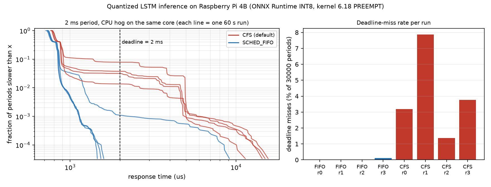

# Quantized LSTM inference as a periodic real-time task on a Raspberry Pi 4B

I took a small LSTM that predicts the remaining useful life (RUL) of turbofan engines (NASA CMAPSS FD001), quantized it to INT8 with ONNX Runtime, and measured two things on a Raspberry Pi 4B:

1. **What quantization costs and gains** — accuracy, single-sample latency, model size, process memory.
2. **Whether the inference can run as a periodic real-time task** — one inference every 2 ms or 10 ms under the default Linux scheduler (CFS) versus `SCHED_FIFO`, with and without a CPU hog on the same core, counting deadline misses.

Everything below was measured on the hardware described here. One 60 s run is one data point; where I repeated a run I say so.



## Setup

| | |
|---|---|
| Board | Raspberry Pi 4 Model B, CPU governor `performance` (1.8 GHz), 43.8 °C idle, no throttling (`vcgencmd get_throttled` = `0x0` before and after) |
| OS / kernel | Raspberry Pi OS Lite 64-bit (Debian 13), `6.18.50+rpt-rpi-v8 #1 SMP PREEMPT` (**not** PREEMPT_RT) |
| Software | Python 3.13.5, NumPy 2.5.4, ONNX Runtime 1.31.1 (CPU provider, 1 thread) |
| Model | 2-layer LSTM, hidden size 64, input 30 steps x 24 features, ~241 KB in fp32 |

## 1. Quantization: accuracy, latency, size, memory

The model is the architecture from the ECE 208 team project (see Credits). Here it is **retrained** with a stricter protocol than the course notebook:

* split **by engine** (80 train / 20 validation engines), so no engine appears in both sets;
* scaler fitted on training engines only; RUL clipped at 125 cycles;
* final numbers on the **official test set** (last window of each of the 100 test engines vs `RUL_FD001.txt`);
* best epoch chosen on the validation set (epoch 4 of 40; validation error rises afterwards, i.e. the model overfits).

The validation numbers are therefore slightly optimistic; use the test column.

| Backend | Model size | Test RMSE | Test MAE | Test R² | NASA score | Val RMSE |
|---|---|---|---|---|---|---|
| PyTorch fp32 (PC) | 241 KB | 14.898 | 10.622 | 0.871 | 381.2 | 12.356 |
| ONNX Runtime fp32 | 241 KB | 14.898 | 10.622 | 0.871 | 381.2 | 12.356 |
| ONNX Runtime INT8 (dynamic) | **71 KB** | 14.956 | 10.696 | 0.870 | 387.2 | 12.369 |

The INT8 model's predictions differ from fp32 by at most 1.22 cycles on the test set. The numbers above were reproduced on the Pi and match the PC run.

Single-sample (batch 1, 1 thread, 3000 timed runs after 300 warm-up runs), on the Pi:

| Backend | mean | p50 | p99 | max | RSS | RSS growth after load |
|---|---|---|---|---|---|---|
| ORT fp32 | 760 µs | 755 µs | 798 µs | 1039 µs | 57.8 MB | 29.5 MB |
| ORT INT8 | **677 µs** | 673 µs | 705 µs | 904 µs | 58.2 MB | 30.0 MB |

INT8 is about 11 % faster and 3.4x smaller, with +0.06 RMSE. **Memory does not improve**: the process footprint is dominated by the ONNX Runtime itself, not by the 241 KB of weights. A model this small does not benefit much from quantization; the point of this part is the measurement, not a large speed-up. PyTorch's own dynamic quantization was not run on the Pi (the PyTorch FBGEMM engine was not available on the PC I trained on, and PyTorch is not installed on the Pi).

## 2. Periodic real-time task

`rt_periodic.py` runs the INT8 model as a periodic task:

* release k at `t0 + k*T`, absolute `clock_nanosleep(CLOCK_MONOTONIC, TIMER_ABSTIME)`; implicit deadline = next release;
* pinned to core 3, `mlockall`, Python GC disabled after warm-up;
* `--policy fifo` uses `SCHED_FIFO` priority 80 (needs root); `--policy other` is the default CFS;
* *response time* = finish time − release time; a *deadline miss* is a response time above the period;
* "stress" = one `stress-ng --cpu 1` process pinned to **the same core 3**, a deliberately harsh case;
* after a stall the loop does not skip releases, so one long stall is counted as several consecutive misses.

I first ran a 10 ms period. There CFS also had no deadline misses even under load (worst response 5.2 ms), so I **shortened the period to 2 ms** (inference takes ~0.7 ms) to see where the schedulers separate. The 2 ms periods under load were repeated 4 times.

| Period | Load | Policy | Runs | Misses per run (of 30000, or 6000 for 10 ms) | Worst response | Median of run p99 |
|---|---|---|---|---|---|---|
| 10 ms | idle | SCHED_FIFO | 1 | 0 | 1561 µs | 950 µs |
| 10 ms | idle | CFS | 1 | 0 | 1815 µs | 938 µs |
| 10 ms | stress | SCHED_FIFO | 1 | 0 | 1711 µs | 1230 µs |
| 10 ms | stress | CFS | 1 | 0 | 5182 µs | 3343 µs |
| 2 ms | idle | SCHED_FIFO | 1 | 0 | 1756 µs | 773 µs |
| 2 ms | idle | CFS | 1 | 3 | 3019 µs | 814 µs |
| 2 ms | stress | SCHED_FIFO | 4 | 0, 0, 0, 32 | 9123 µs | 918 µs |
| 2 ms | stress | CFS | 4 | 956, 2359, 409, 1130 | 15612 µs | 4576 µs |

**Reading it:** with a CPU hog on the same core and a 2 ms period, CFS missed 1.4 %–7.9 % of the deadlines per run (worst response ~15 ms). `SCHED_FIFO` missed none in three of four runs and 0.1 % in the fourth, and its typical worst response was ~1.5 ms.

**The one SCHED_FIFO anomaly.** In the fourth loaded run, at about 17.5–18.6 s into the run, there were at least three separate stalls of roughly 3–7 ms (wake-up lateness up to 7.3 ms), each followed by a catch-up sequence of late periods. That accounts for the 32 misses. I have not identified the cause. Plausible candidates are non-preemptible kernel sections or interrupt/softirq work (for example Wi-Fi, since I was logged in over Wi-Fi) on the same core; this kernel is `PREEMPT`, not `PREEMPT_RT`. I did not test these hypotheses. The honest statement is: on this stack, `SCHED_FIFO` reduced the miss rate from 1.4 %–7.9 % to 0 %–0.1 % and cut the typical worst-case response by about an order of magnitude, but it did not give a hard guarantee.

## Limitations

* Python + ONNX Runtime adds jitter; a C/C++ implementation would likely have a lower tail.
* One interfering process on the same core is a specific worst case, not a general workload.
* Only 1–4 runs of 60 s per configuration; no confidence intervals.
* Standard (`PREEMPT`) kernel only; no core isolation (`isolcpus`), IRQ affinity tuning or `PREEMPT_RT` comparison yet. These are the obvious next experiments.
* ONNX Runtime dynamic INT8 only; static quantization and PyTorch quantization on the Pi were not tried.
* Evaluated on one dataset (FD001) with a model that overfits after a few epochs.

## Reproduce

```bash
pip install -r requirements.txt
# put NASA CMAPSS data in ./CMAPSSData (train_FD001.txt, test_FD001.txt, RUL_FD001.txt)
python train.py                  # trains, saves artifacts/ (fp32 weights, scaler, eval samples)
python export_quant.py           # ONNX export + INT8 dynamic quantization
python eval_accuracy.py          # accuracy of every backend
```
On the Pi (copy `artifacts/` and the scripts; needs `numpy pandas psutil onnxruntime`, and `stress-ng` for the loaded runs):
```bash
echo performance | sudo tee /sys/devices/system/cpu/cpu*/cpufreq/scaling_governor
python bench_latency.py
./run_rt_experiments.sh ort_int8 10 60     # idle/stress x CFS/SCHED_FIFO at 10 ms
./run_rt_experiments.sh ort_int8 2 60      # same at 2 ms
python plot_results.py                     # tables + figure (run on a PC with matplotlib)
```
CSVs of every run are in `results/`.

## Layout
`train.py`, `export_quant.py`, `eval_accuracy.py`, `bench_latency.py`, `rt_periodic.py`, `run_rt_experiments.sh`, `plot_results.py`, `analyze_rt.py`, `src/` (data pipeline, model, backends), `results/` (CSV, tables, figure).

## Credits
* The LSTM architecture and the original training notebook come from the ECE 208 team project at the University of Rochester with Cheng (Tony) Ke and Felipe Villanueva: [Predictive-Maintenance-for-Aerospace-Systems-RUL-Prediction](https://github.com/FrozenEel/Predictive-Maintenance-for-Aerospace-Systems-RUL-Prediction). This repository's data pipeline, evaluation protocol, export, quantization, benchmarking and real-time experiments are new.
* Dataset: NASA CMAPSS turbofan engine degradation simulation (NASA Prognostics Center of Excellence data set repository).
* **AI assistance:** I used Claude (Anthropic) to help write the scripts, plan the experiments and draft this README. I ran every experiment on my own hardware, and the numbers above are copied from the outputs of those runs.
